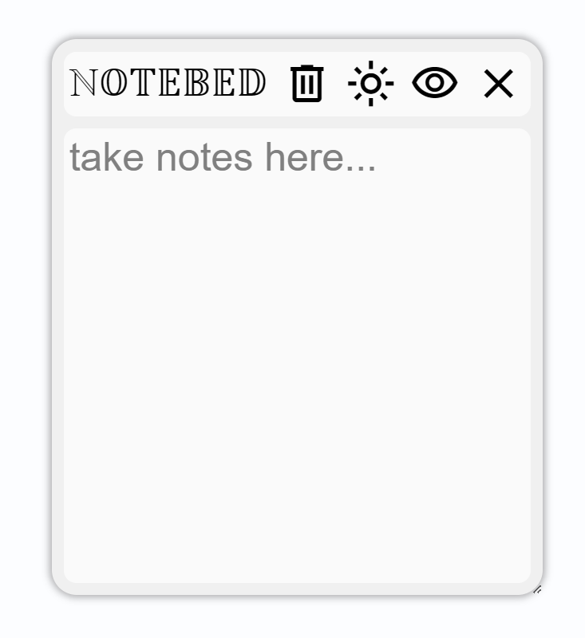
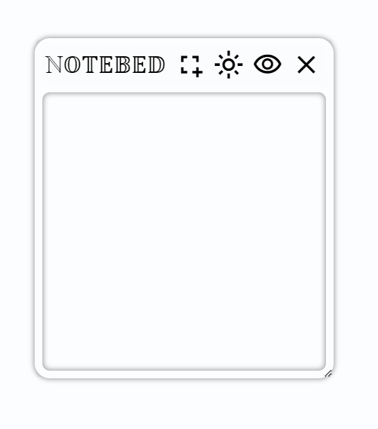

## NOTEBED
a collection of bookmarketlet
> bookmarket is a small computer program stored as a bookmark that runs js on the current web-page when clicked

### Preview
|||
|-|-|
|notepad|snapshot|

#### notepad
a note pad with
- resizeable box
- light/dark theme
- automatically local storage (note, position, size)

#### snapshot
pin a screenshot
- resizeable box
- light/dark theme
- automatically local storage (position, size)

### Made With
- JS: bookmarklet
- HTML/CSS/JS: demo web site
- [Bookmarklet Maker](https://bookmarklets.org/maker/)

### Getting Started
Go [Github Page](https://klhrd.github.io/notebed/) and follow the step